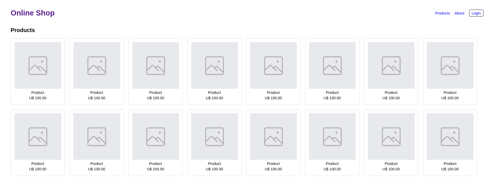

# Online Shop

A simple online store page, created as a **study exercise** to practice the CSS `display` property, mainly **Flexbox**.

> This project is for practice only. The products, prices, and links are fictional.



## What was practiced

- `display: flex` in the header, with `justify-content: space-between` and `align-items: center` to separate the title from the menu.
- Nested flex in the navigation menu, using `gap` for spacing between links.
- `flex-wrap: wrap` on the product list, so the cards wrap onto new lines automatically.
- Card styling with `border`, `border-radius`, and `padding`.
- Login button built with CSS only, from a regular link.

## Project structure

```
online-shop/
├── index.html      # Page structure
├── style.css       # Styles
├── README.md       # Project documentation
└── img/
    ├── img-icon.png  # Image used as a product placeholder
    └── preview.png   # Page screenshot used in this README
```

## How to run

No installation needed. Just clone the repository and open `index.html` in your browser:

```bash
git clone https://github.com/marianacoqueiro/online-shop.git
cd online-shop
```

Then open the `index.html` file by double-clicking it or dragging it into your browser.

## Possible future improvements

- [ ] Make the page responsive
- [ ] Create the About page
- [ ] Create the Login page (visual only, no authentication)
- [ ] Add a purchase simulation with a shopping cart (requires JavaScript)

## Technologies

- HTML5
- CSS3

## Author

Made by [Mariana Coqueiro](https://github.com/marianacoqueiro) as part of web development studies.